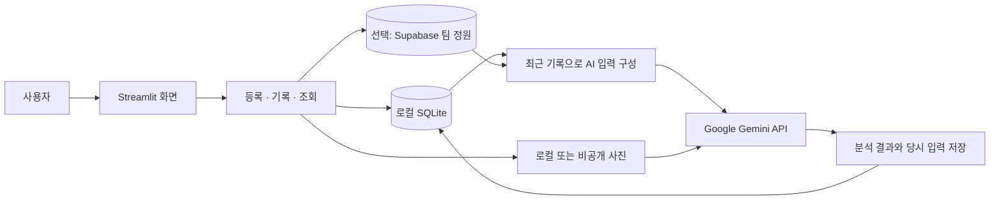

# 🌿 내 식물 기록 · Plant Care AI

> 물 준 날과 작은 변화를 쌓아, 내 식물에 맞는 다음 관리를 찾아가는 앱


**[빠른 시작](#빠른-시작)** · **[개발 계획](docs/ROADMAP.md)** · **[작업 목록](https://github.com/Mhoyoung/plant-care-ai/issues)** · **[변경 기록 · PR](https://github.com/Mhoyoung/plant-care-ai/pulls?q=is%3Apr)**

- **현재 상태:** 팀원들과 테스트하는 Python 웹 시제품. 식물·관리 기록, Gemini 분석, 제안·실행·경과와 지역 날씨를 연결했습니다.
- **사용 준비:** AI 분석은 본인의 Gemini 키가 필요합니다. [무료 구간 설정](docs/AI_SETUP.md)
- **팀원 저장소:** Supabase와 비공개 사진 저장소를 연결할 수 있습니다. [기존 정원 백업·연결 안내](docs/CLOUD_STORAGE.md)
- **모바일 우선:** 정원·등록·AI 비교 바로가기와 오늘 상태 기록을 휴대폰에서 쉽게 사용하도록 구성했습니다. [화면 흐름](docs/MOBILE_UX.md)
- **AI 비교:** 가상 사례 또는 내 식물의 같은 상태·사진에 과거 기록만 달리 전달합니다. [비교 방법과 한계](docs/AI_COMPARISON.md)
- **다음 목표:** 실제 식물로 반복 사용·제안 품질 검증과 AI 파트너 마스코트.
- **개발 방식:** 혼자 개발하며 기능 단위로 작게 구현하고 직접 사용해봅니다.


*실제 내 정원 화면입니다. 사진 없는 식물은 예시 일러스트로 표시합니다. 식물 카드를 열면 한눈에 보기·관리 기록·AI 분석 탭을 사용할 수 있습니다.*

## 어떤 앱인가요?

식물 사진 한 장뿐 아니라 **언제 물을 줬고, 어떤 관리를 했고, 이후 어떻게 달라졌는지**를 함께 남기는 앱입니다.
누적한 기록과 관리 결과를 다음 제안에 반영하는 식물 관리 파트너를 목표로 합니다.

| 사용자의 질문 | 현재 할 수 있는 일 | 다음에 만들 기능 |
|---|---|---|
| 이 식물은 어디서 어떻게 키우고 있지? | 이름·종류·장소·처음 상태·사진 등록 | 환경 정보를 분석에 반영 |
| 마지막으로 물 준 날이 언제였지? | 마지막 물주기와 관리 타임라인 조회 | 상황에 맞는 다음 관리 제안 |
| 관리한 뒤 상태가 나아졌을까? | AI 제안에 실제 실행·경과를 연결하고 다음 분석에 반영 | 실제 식물로 반복 사용·비교 평가 |

## 구현 범위

| 기능 | 상태 | 내용 |
|---|---|---|
| 내 정원 | ✅ 구현 | 식물 카드, 관리·분석 건수와 식물별 상세 탭 |
| 식물 등록 | ✅ 구현 | 식물별 기본 정보와 사진 저장 |
| 관리 기록 | ✅ 구현 | 물주기·비료·분갈이·상태 관찰 |
| 타임라인 | ✅ 구현 | 날짜순 기록, 마지막 물주기 조회 |
| 데이터 보관 | ✅ 구현 | 로컬 SQLite 또는 Supabase 연결, 사진 포함 정원 전체 백업·이전 |
| AI 입력 구성 | ✅ 구현 | 현재 질문·관리 기록 최대 30건·이전 제안 최대 10건과 실행·최근 경과·선택 사진 1장 |
| AI 분석·관리 제안 | ✅ 연동 구현 | Gemini 호출과 결과 저장. 실제 호출은 본인 키 설정 후 확인 |
| 제안·실행·경과 연결 | ✅ 구현 | 실제 관리와 이후 관찰을 구분해 저장하고 다음 분석 입력으로 전달 |
| 날씨 연동 | ✅ 구현 | 선택한 도시의 실외 모델 날씨, 시각·출처 저장, 실패 시 기록으로 분석 |
| 모바일 관리 흐름 | ✅ 웹 구현 | 상단 메뉴, 상태 기록 바로가기, 휴대폰의 한 열 화면 |
| 기록 유무 AI 비교 | ✅ 구현 | 가상 사례/내 기록, 수동 호출 2회, 동일 입력 비교와 평가·JSON 다운로드 |
| 로그인·모바일 출시 | ⏳ 검토 | 웹 시제품을 사용해본 뒤 범위 결정 |

**등록·기록은 키 없이 실행할 수 있습니다.** AI 분석은 Gemini의 Free Tier 프로젝트 키로 시작합니다.
프로젝트에 결제를 연결하면 과금될 수 있으므로 무료 구간 여부를 확인하세요.
날씨는 추가 키 없이 Open-Meteo의 비상업 무료 API를 사용합니다. [지역 날씨 안내](docs/WEATHER.md)

## 빠른 시작

Python **3.12**와 Git을 준비한 뒤, Windows PowerShell에서 차례대로 실행하세요.

```powershell
git clone https://github.com/Mhoyoung/plant-care-ai.git
cd plant-care-ai
py -m venv .venv
.\.venv\Scripts\python.exe -m pip install -r requirements.txt
.\.venv\Scripts\python.exe -m streamlit run app.py
```

브라우저에서 <http://localhost:8501>을 엽니다. 종료는 터미널에서 `Ctrl+C`를 누릅니다.
`py`가 없다면 가상환경을 만드는 줄에서 `python -m venv .venv`를 사용하세요.

Git 없이 시작하려면 GitHub의 **Code → Download ZIP**으로 내려받고, 압축을 푼 `app.py` 폴더에서 가상환경 생성부터 실행하면 됩니다.
macOS·Linux 실행법, 테스트와 데이터 백업은 [상세 실행 안내](docs/RUNNING.md)에 있습니다.

AI를 사용하려면 [Gemini 설정 안내](docs/AI_SETUP.md)에 따라 `.streamlit/secrets.toml`에 키를 입력합니다.
비밀키·개인 기록·사진은 GitHub 업로드 대상에서 제외합니다.

### 처음 확인할 것

1. `몬스테라 A`를 등록합니다.
2. 물주기 기록과 상태 메모를 저장합니다.
3. 상태 관찰을 추가하고 이전 기록과 비교한 경과를 남깁니다.
4. 앱을 종료했다가 다시 켜서 식물과 기록이 유지되는지 확인합니다.

AI를 설정했다면 **AI 분석 → 다음 관리 제안 → 관리 기록 남기기**에서 실제로 한 관리를 저장합니다.
이후 **이후 상태 남기기**로 사진·메모·경과를 남기면 다음 분석에 함께 전달됩니다.
제안 하나에는 실행 기록 한 건과 이후 관찰 여러 건을 연결할 수 있습니다. [관리 흐름 안내](docs/CARE_LOOP.md)

## 기술 구성



| 구성 | 사용 기술 | 역할 |
|---|---|---|
| 화면 | Python · Streamlit · CSS · SVG | 내 정원, 식물 카드, 상세 탭과 입력 폼 |
| 기록 | SQLite · 선택적 Supabase PostgreSQL · Python 표준 라이브러리 | 검증·조회와 팀 정원 영구 저장 |
| 사진 | Pillow | 사진 검증, 크기 조정, 메타데이터 제거 |
| AI | Gemini Interactions REST · Python 표준 라이브러리 | 사진·기록 분석, 구조화된 결과, 수동 호출 |
| 검증 | unittest · Streamlit AppTest | 저장·재조회와 화면 동작 확인 |

Python 3.12.14, Streamlit 1.65.0, Pillow 12.3.0 환경에서 테스트 **52개가 통과**했습니다.
AI 테스트는 모의 API 응답으로 실행하며 실제 Gemini 요청이나 비용을 발생시키지 않습니다.
[테스트 실행 방법](docs/RUNNING.md#테스트)

## 저장소 구조

```text
app.py                        # Streamlit 화면
assets/                       # 정원 스타일과 식물 일러스트
plant_care/
  ui.py                       # 식물 카드·요약·타임라인 표시
  storage.py                  # SQLite 저장·조회
  cloud_store.py              # Supabase 버전 비교 저장·비공개 사진
  store_factory.py            # 로컬 또는 팀원용 저장소 선택
  snapshot.py                 # 정원 스냅샷과 사진 포함 전체 백업
  data_ui.py                  # 백업 준비·내려받기·기존 정원 이전
  media.py                    # 사진 검증·저장
  ai_context.py               # 최근 기록을 AI 입력으로 구성
  gemini.py                   # Gemini 요청·응답 검증·오류 처리
  ai_ui.py                    # 분석 폼과 저장 결과 표시
  care_ui.py                  # 제안 실행·경과 기록과 연결 화면
  weather.py                  # 지역 실외 날씨 요청·수치·시각 검증
  weather_ui.py               # 지역 설정과 날씨 표시
  constants.py                # 관리 종류와 경과 값
tests/                        # 저장소·화면 테스트
docs/
  RUNNING.md                  # 실행·테스트·데이터·백업
  ROADMAP.md                  # 개발 순서·예상 기간
  DEVELOPMENT.md              # 혼자 쓰는 Issue·PR 작업 흐름
  AI_SETUP.md                 # 무료 구간·키 설정·분석 사용법
  CARE_LOOP.md                # 제안·실행·경과 연결 사용법
  WEATHER.md                  # 지역 날씨 설정·전송·저장·한계
  CLOUD_STORAGE.md            # 외부 저장소 설정·백업·팀원 사용
  images/                     # 실제 앱 화면
.github/                      # Issue·PR 작성 양식
requirements.txt              # 필요한 외부 라이브러리
supabase/setup.sql            # 비공개 저장 구조·버전 비교 RPC
.gitignore                    # 개인 데이터·비밀키 제외
```

## 데이터와 사용 범위

- 기본 로컬 모드에서는 `data/` 폴더에 기록과 사진을 저장하며 GitHub 업로드에서 제외합니다.
- Supabase 모드를 설정하면 하나의 팀 정원을 외부 DB·비공개 사진 저장소에 보관합니다. 임시 SQLite는 검증·조회용이며 원본 저장소는 Supabase입니다.
- 식물별 JSON에는 사진 파일이 없습니다. **기록 보관과 백업**에서 준비하는 전체 정원 ZIP에는 사진도 포함됩니다.
- 팀원 접근은 Streamlit 비공개 초대로 제한합니다. 앱 자체의 개인별 정원·접근 역할은 아직 구현하지 않았습니다.
- AI 분석 시 선택한 정보가 Google에 전달됩니다. Free Tier의 입력·출력은 제품 개선에 사용될 수 있습니다. [설정·데이터 안내](docs/AI_SETUP.md)
- 외부 저장소 연결 실패 시 로컬로 자동 전환하지 않습니다. 동시 수정은 뒤의 저장을 거부해 먼저 저장한 기록을 유지합니다.
- Supabase 무료 프로젝트는 활동 부족 시 일시정지될 수 있으며 별도 백업이 필요합니다. [설정과 검증 범위](docs/CLOUD_STORAGE.md)

사진 제한과 저장 위치 변경은 [상세 실행 안내](docs/RUNNING.md#데이터와-사진)에 있습니다.
GitHub 업로드와 다른 사람이 접속할 수 있는 서비스 배포는 별도 작업입니다.

## Issue · PR

**Issue는 앞으로 할 일, PR은 실제 바꾼 내용과 확인 결과**를 남기는 공간으로 사용합니다.

| 변경 규모 | 추천 방식 |
|---|---|
| 오타·짧은 설명 수정 | 커밋으로 기록 |
| 기능 추가·버그 수정 | Issue에 목표와 완료 기준 작성 → 작업 브랜치 → PR → 확인 후 병합 |
| AI·DB·저장 방식 변경 | PR에 입력·출력 변화, 검증 결과, 기존 기록에 미치는 영향 작성 |

혼자 확인하고 병합해도 됩니다. 다른 사람의 승인을 필수로 요구하지 않습니다.
Issue에는 **기능 작업·버그 보고** 양식을, PR에는 **변경·이유·검증** 양식을 준비했습니다.
브랜치 명령과 예시는 [개발 안내](docs/DEVELOPMENT.md)를 참고하세요.

## 다음 개발

1. **기록 기능 익히기:** 직접 등록하고 기록을 남겨보기
2. **AI 연결 확인:** Gemini 키 설정 후 실제 분석 결과·입력 기록·사진을 확인하기
3. **관리 흐름 검증:** 구현한 제안·실행·경과 연결을 실제 식물로 반복 사용하기
4. **날씨와 시연:** 지역 날씨를 포함해 분석하고, 기록 유무에 따른 제안 비교하기

하루 1–2시간씩 배우면서 진행한다면 발표 가능한 웹 시제품까지 **약 4–8주**를 예상합니다.
범위·진행 속도에 따라 달라지며 모바일 출시는 별도 일정입니다. [상세 개발 계획](docs/ROADMAP.md)

## 참고

- 기술 문서: [Streamlit](https://docs.streamlit.io/) · [Python SQLite](https://docs.python.org/3/library/sqlite3.html)
- 작업 양식: [GitHub Issue·PR 템플릿 안내](https://docs.github.com/en/communities/using-templates-to-encourage-useful-issues-and-pull-requests/about-issue-and-pull-request-templates)
- 문서 구성 참고: [Wave 바람길](https://github.com/Willow33426/wave-windpath) — 소개·구현 범위·구조·작업 기록의 배치 방식을 참고했습니다.
