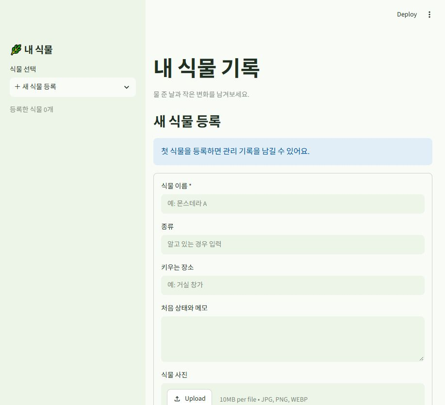
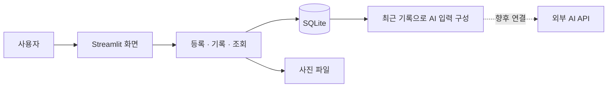

# 🌿 내 식물 기록 · Plant Care AI

> 물 준 날과 작은 변화를 쌓아, 내 식물에 맞는 다음 관리를 찾아가는 앱


**[빠른 시작](#빠른-시작)** · **[개발 계획](docs/ROADMAP.md)** · **[작업 목록](https://github.com/Mhoyoung/plant-care-ai/issues)** · **[변경 기록 · PR](https://github.com/Mhoyoung/plant-care-ai/pulls?q=is%3Apr)**

- **현재 상태:** 개인 PC에서 실행하는 Python 웹 시제품. 식물 등록과 관리 기록이 동작합니다.
- **다음 목표:** 사진·상태·과거 기록을 함께 참고하는 AI 분석과 지역 날씨 연동.
- **개발 방식:** 혼자 개발하며 기능 단위로 작게 구현하고 직접 사용해봅니다.



*현재 앱을 실행해 촬영한 식물 등록 화면입니다. AI 분석 화면은 아직 구현하지 않았습니다.*

## 어떤 앱인가요?

식물 사진 한 장뿐 아니라 **언제 물을 줬고, 어떤 관리를 했고, 이후 어떻게 달라졌는지**를 함께 남기는 앱입니다.
누적한 기록과 관리 결과를 다음 제안에 반영하는 식물 관리 파트너를 목표로 합니다.

| 사용자의 질문 | 현재 할 수 있는 일 | 다음에 만들 기능 |
|---|---|---|
| 이 식물은 어디서 어떻게 키우고 있지? | 이름·종류·장소·처음 상태·사진 등록 | 환경 정보를 분석에 반영 |
| 마지막으로 물 준 날이 언제였지? | 마지막 물주기와 관리 타임라인 조회 | 상황에 맞는 다음 관리 제안 |
| 관리한 뒤 상태가 나아졌을까? | 사진·메모·호전/변화 없음/악화 기록 | AI 제안과 실제 실행·경과 연결 |

## 구현 범위

| 기능 | 상태 | 내용 |
|---|---|---|
| 식물 등록 | ✅ 구현 | 식물별 기본 정보와 사진 저장 |
| 관리 기록 | ✅ 구현 | 물주기·비료·분갈이·상태 관찰 |
| 타임라인 | ✅ 구현 | 날짜순 기록, 마지막 물주기 조회 |
| 데이터 보관 | ✅ 구현 | SQLite 저장, 재실행 후 유지, JSON 다운로드 |
| AI 입력 구성 | ✅ 구현 | 최근 기록을 묶는 함수. 실제 AI 호출은 없음 |
| AI 분석·관리 제안 | ⏳ 예정 | 현재 사진·상태·과거 기록을 함께 분석 |
| 날씨 연동 | ⏳ 예정 | 지역 날씨와 실제 식물 환경 구분 |
| 로그인·모바일 출시 | ⏳ 검토 | 웹 시제품을 사용해본 뒤 범위 결정 |

**현재 버전은 유료 API 키 없이 실행할 수 있습니다.** AI API와 날씨 API는 아직 연결하지 않았습니다.

## 빠른 시작

Python **3.12**와 Git을 준비한 뒤, Windows PowerShell에서 차례대로 실행하세요.

```powershell
git clone https://github.com/Mhoyoung/plant-care-ai.git
cd plant-care-ai
py -m venv .venv
.\.venv\Scripts\python.exe -m pip install -r requirements.txt
.\.venv\Scripts\python.exe -m streamlit run app.py
```

브라우저에서 <http://localhost:8501>을 엽니다. 종료는 터미널에서 `Ctrl+C`를 누릅니다.
`py`가 없다면 가상환경을 만드는 줄에서 `python -m venv .venv`를 사용하세요.

Git 없이 시작하려면 GitHub의 **Code → Download ZIP**으로 내려받고, 압축을 푼 `app.py` 폴더에서 가상환경 생성부터 실행하면 됩니다.
macOS·Linux 실행법, 테스트와 데이터 백업은 [상세 실행 안내](docs/RUNNING.md)에 있습니다.

### 처음 확인할 것

1. `몬스테라 A`를 등록합니다.
2. 물주기 기록과 상태 메모를 저장합니다.
3. 상태 관찰을 추가하고 이전 기록과 비교한 경과를 남깁니다.
4. 앱을 종료했다가 다시 켜서 식물과 기록이 유지되는지 확인합니다.

## 기술 구성



| 구성 | 사용 기술 | 역할 |
|---|---|---|
| 화면 | Python · Streamlit | 등록 폼, 타임라인, 다운로드 |
| 기록 | SQLite · Python 표준 라이브러리 | 식물과 관리 기록 저장 |
| 사진 | Pillow | 사진 검증, 크기 조정, 메타데이터 제거 |
| 검증 | unittest · Streamlit AppTest | 저장·재조회와 화면 동작 확인 |

Python 3.12.14, Streamlit 1.65.0, Pillow 12.3.0 환경에서 기존 테스트 **12개가 통과**했습니다.
[테스트 실행 방법](docs/RUNNING.md#테스트)

## 저장소 구조

```text
app.py                        # Streamlit 화면
plant_care/
  storage.py                  # SQLite 저장·조회
  media.py                    # 사진 검증·저장
  ai_context.py               # 최근 기록을 AI 입력으로 구성
  constants.py                # 관리 종류와 경과 값
tests/                        # 저장소·화면 테스트
docs/
  RUNNING.md                  # 실행·테스트·데이터·백업
  ROADMAP.md                  # 개발 순서·예상 기간
  DEVELOPMENT.md              # 혼자 쓰는 Issue·PR 작업 흐름
  images/                     # 실제 앱 화면
.github/                      # Issue·PR 작성 양식
requirements.txt              # 필요한 외부 라이브러리
.gitignore                    # 개인 데이터·비밀키 제외
```

## 데이터와 사용 범위

- 기록과 사진은 내 PC의 `data/` 폴더에 저장합니다. `.gitignore`로 GitHub 업로드에서 제외합니다.
- JSON 다운로드에는 사진 파일이 포함되지 않습니다. 전체 백업은 앱 종료 후 `data/` 폴더를 복사합니다.
- 현재 앱은 한 사람이 자기 PC에서 사용하는 시제품입니다. 로그인과 사용자별 접근 권한은 아직 없습니다.
- 여러 사람에게 배포할 때는 사용자 구분과 영구 저장소를 먼저 구현해야 합니다.

사진 제한과 저장 위치 변경은 [상세 실행 안내](docs/RUNNING.md#데이터와-사진)에 있습니다.
GitHub 업로드와 다른 사람이 접속할 수 있는 서비스 배포는 별도 작업입니다.

## 혼자 개발할 때의 Issue · PR

**Issue는 앞으로 할 일, PR은 실제 바꾼 내용과 확인 결과**를 남기는 공간으로 사용합니다.

| 변경 규모 | 추천 방식 |
|---|---|
| 오타·짧은 설명 수정 | 커밋으로 기록 |
| 기능 추가·버그 수정 | Issue에 목표와 완료 기준 작성 → 작업 브랜치 → PR → 확인 후 병합 |
| AI·DB·저장 방식 변경 | PR에 입력·출력 변화, 검증 결과, 기존 기록에 미치는 영향 작성 |

혼자 확인하고 병합해도 됩니다. 다른 사람의 승인을 필수로 요구하지 않습니다.
Issue에는 **기능 작업·버그 보고** 양식을, PR에는 **변경·이유·검증** 양식을 준비했습니다.
브랜치 명령과 예시는 [개발 안내](docs/DEVELOPMENT.md)를 참고하세요.

## 다음 개발

1. **기록 기능 익히기:** 직접 등록하고 기록을 남겨보기
2. **AI 첫 연동:** 현재 사진·상태 분석 결과를 표시하고 저장하기
3. **관리 결과 반영:** 이전 제안 → 실제 실행 → 경과를 다음 분석에 포함하기
4. **날씨와 시연:** 환경 정보 연동, 기록 유무에 따른 제안 비교하기

하루 1–2시간씩 배우면서 진행한다면 발표 가능한 웹 시제품까지 **약 4–8주**를 예상합니다.
범위·진행 속도에 따라 달라지며 모바일 출시는 별도 일정입니다. [상세 개발 계획](docs/ROADMAP.md)

## 참고

- 기술 문서: [Streamlit](https://docs.streamlit.io/) · [Python SQLite](https://docs.python.org/3/library/sqlite3.html)
- 작업 양식: [GitHub Issue·PR 템플릿 안내](https://docs.github.com/en/communities/using-templates-to-encourage-useful-issues-and-pull-requests/about-issue-and-pull-request-templates)
- 문서 구성 참고: [Wave 바람길](https://github.com/Willow33426/wave-windpath) — 소개·구현 범위·구조·작업 기록의 배치 방식을 참고했습니다.
