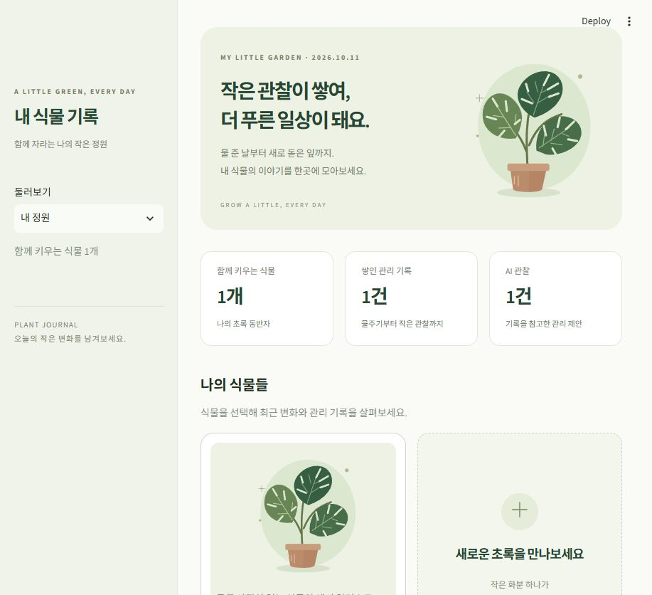
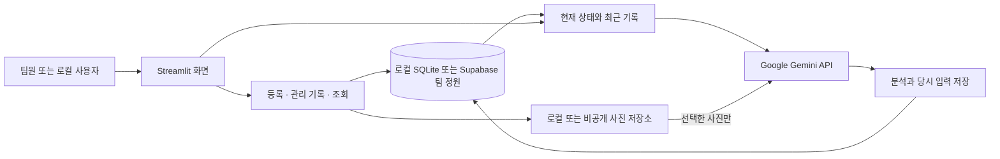

# 🌿 내 식물 기록 · Plant Care AI

> 물 준 날과 작은 변화를 쌓아, 내 식물에 맞는 다음 관리를 찾아가는 앱


**[공유 앱 열기](https://plant-care-ai-bh5dtxenovacdz7hc4bdvj.streamlit.app/)** · **[팀원 사용·테스트 안내](docs/TEAM_TESTING.md)** · **[내 PC에서 실행](#내-pc에서-실행)** · **[개발 계획](docs/ROADMAP.md)**

사진과 관리 기록을 함께 참고해 **확인할 사항 → 조건에 맞는 관리 → 이후 관찰**을 연결하는 Python 웹 시제품입니다.
기본 기능과 모바일 웹 화면은 구현했으며, 현재는 팀원이 사용해 보면서 사용성과 AI 제안 품질을 검증하는 단계입니다.
실제 식물의 진단 정확도나 회복 효과를 입증한 제품은 아닙니다.

## 팀원이 처음 사용할 때

1. 위 **공유 앱** 링크를 휴대폰 또는 PC에서 엽니다.
2. 로그인·접근 권한 안내가 나오면 관리자가 초대한 이메일 계정으로 접속합니다. 접근되지 않으면 관리자에게 확인을 요청하세요.
3. **내 정원 → 식물 살펴보기 → 관리 기록 / AI 분석** 순서로 둘러봅니다.

공유 앱에서는 **Python 설치, 저장소 다운로드, 개인 API 키 준비가 필요하지 않습니다.** Gemini와 저장소 연결은 앱 관리자가 설정합니다.
앱 자체에 별도 회원가입이나 개인별 정원 기능은 없으며, 초대된 팀원이 **하나의 정원과 기록을 함께 사용**합니다.
등록한 메모·사진·분석은 같은 앱의 다른 팀원도 볼 수 있습니다.

실제 식물이 없다면 **AI 비교 → 예시 사례**로 시작할 수 있습니다. 등록·기록 시험용 자료에는 이름과 메모에 `[테스트]` 및 실제 관찰이 아님을 표시하세요.
AI 요청은 버튼을 눌렀을 때만 발생하며 공유 앱의 Gemini 프로젝트 한도를 함께 사용합니다.
읽기·화면 이동·관리 기록 저장은 Gemini를 호출하지 않습니다.

[팀원 테스트 순서와 피드백 양식](docs/TEAM_TESTING.md)에서 그대로 따라 해볼 수 있습니다.



*사진 없는 식물은 예시 일러스트로 표시합니다. 식물 상세에는 한눈에 보기·관리 기록·AI 분석 탭이 있습니다.*

## 현재 할 수 있는 일

| 기능 | 사용 흐름 |
|---|---|
| 식물 등록 | 이름·종류·키우는 장소·처음 상태·선택 사진 저장 |
| 관리 기록 | 물주기·비료·분갈이·상태 관찰, 사진과 날짜별 타임라인 |
| 케어 일정 | 직접 입력 또는 저장된 AI 제안으로 초안 생성, 날짜·종류 확인 후 저장, 실제 완료·캘린더 연결 |
| AI 분석 | 현재 질문·선택 사진·최근 관리 기록·이전 제안과 경과를 Gemini에 전달 |
| 읽기 쉬운 안내 | 새싹의 짧은 안내와 확인 카드 최대 3개, 나머지 확인 사항·관리 조건·한계·전체 원문 펼쳐보기 |
| 관리 결과 연결 | AI 제안에 실제 실행 1건과 이후 관찰 여러 건을 연결해 다음 분석에 참고 |
| 지역 날씨 | 순천을 포함한 도시 선택, 실외 모델 날씨를 수동 확인하고 선택적으로 분석에 포함 |
| AI 비교 | 같은 현재 상태·사진에서 과거 기록만 제외/포함해 두 답변을 평가하고 내려받기 |
| 기록 보관 | 내 PC의 SQLite 또는 Supabase 팀 정원, 사진 포함 전체 정원 ZIP 백업 |

관리 기록은 모델을 새로 학습시키는 데이터가 아니라 **다음 요청의 참고 문맥**으로 전달합니다.
날씨는 도시 대표 좌표의 실외 추정치이며 실제 실내 환경이나 흙 수분을 측정한 값이 아닙니다.
사진·기록으로 확인하지 못한 사항은 직접 확인한 뒤 관리해야 합니다.

아직 남은 작업은 실제 식물로 반복 사용하기, AI 제안 평가, 팀원 사용성 점검입니다.
개인별 계정·정원 분리, 앱 자체 푸시, 앱스토어 출시는 이후 범위이며 현재 앱은 모바일 웹입니다.
휴대폰 알림은 [캘린더 연동](docs/CARE_SCHEDULES.md)으로 시작합니다. 가져온 일정과 알림을 캘린더에서 확인하며, 앱과 자동 동기화되지 않습니다.
유사 서비스의 마스코트·기록·날씨 기능과 [우리의 참고 방향](docs/COMPETITORS.md)을 정리했습니다.

## 내 PC에서 실행

이 부분은 **코드를 수정하거나 별도의 로컬 정원을 만들 사람**을 위한 안내입니다.
로컬 정원은 공유 앱의 팀 정원과 자동 동기화되지 않습니다.

Python **3.12**와 Git을 준비한 뒤 Windows PowerShell에서 실행하세요.

```powershell
git clone https://github.com/Mhoyoung/plant-care-ai.git
cd plant-care-ai
py -3.12 -m venv .venv
.\.venv\Scripts\python.exe -m pip install -r requirements.txt
.\.venv\Scripts\python.exe -m streamlit run app.py
```

브라우저에서 <http://localhost:8501>을 엽니다. 종료는 터미널에서 `Ctrl+C`입니다.
`py`가 없다면 Python 3.12의 `python --version`을 확인하고 `python -m venv .venv`를 사용하세요.
Git 없이 시작하려면 **Code → Download ZIP**으로 받고 압축을 푼 `app.py` 폴더에서 가상환경 생성부터 실행합니다.
macOS·Linux, 데이터 위치와 백업은 [상세 실행 안내](docs/RUNNING.md)에 있습니다.

**식물 등록·관리 기록은 API 키 없이 사용할 수 있습니다.** 내 PC에서 AI를 쓰려면 [Gemini 설정](docs/AI_SETUP.md)에 따라 로컬 키를 준비합니다.
공유 앱의 서버용 키를 팀원에게 배포하지 않습니다. 로컬 테스트에 원격 팀 정원을 연결하려면 관리자가 먼저 저장소 설정과 사용 범위를 확인해야 합니다.

## 테스트와 확인 범위

```powershell
.\.venv\Scripts\python.exe -m unittest discover -s tests -v
```

2026-10-15 Python 3.12 환경에서 **테스트 76개가 통과**했습니다.
임시 데이터와 모의 API로 실행하므로 실제 정원에 테스트 기록을 추가하거나 Gemini를 호출하지 않습니다.

| 확인한 범위 | 아직 별도로 확인할 범위 |
|---|---|
| 등록·사진·기록 저장과 재조회, 실행·경과 연결 | 여러 날 실제 식물을 관리하며 얻은 결과 |
| AI 입력 구성, 전송 동의, 오류·429 처리, 화면 이동 시 불필요한 호출 방지 | AI 제안의 내용 타당성과 사용자가 이해하는 정도 |
| 원격 저장 모의 테스트, 동시 저장 충돌과 백업·복원 | 팀원들의 다양한 휴대폰·브라우저에서의 사용성 |
| 한국 새벽의 날짜 입력·저장, 미래 기록 거부 | 장기간 사용 시 데이터 증가와 운영 비용 |
| 일정 추가·수정·취소·중복 완료 방지, 기존 백업 호환, 한국 시간 캘린더 내보내기 | 이번 변경의 모바일 실화면과 휴대폰 캘린더 알림 수신 |

실제 공유 앱에서는 Supabase 연결과 재시작 후 기록·사진 보존, 예시 입력으로 Gemini 응답을 확인했습니다.
이 연결 확인과 **실제 식물의 분석 품질 검증은 구분**합니다. 최신 동작·제한은 아래 문서를 참고하세요.

## 구성과 문서



| 위치 | 역할 |
|---|---|
| `app.py`, `assets/` | 정원·등록·상세 화면, CSS와 식물 일러스트 |
| `plant_care/storage.py`, `cloud_store.py`, `store_factory.py` | 기록 검증과 로컬/원격 저장 |
| `plant_care/media.py`, `snapshot.py`, `data_ui.py` | 사진 처리와 전체 정원 백업·이전 |
| `plant_care/ai_context.py`, `gemini.py`, `ai_ui.py` | AI 입력, 요청·오류 처리, 분석 화면 |
| `plant_care/insight_ui.py`, `care_ui.py` | 새싹 안내·확인 카드, 제안·실행·경과 연결 |
| `plant_care/comparison.py`, `comparison_ui.py` | 정원 DB와 분리된 AI 비교 실험 |
| `plant_care/weather.py`, `weather_ui.py`, `time_utils.py` | 지역 날씨와 한국 기준 기록 날짜 |
| `tests/`, `.github/` | 자동 테스트와 Issue·PR 양식 |
| `requirements.txt`, `supabase/setup.sql` | 외부 라이브러리 목록과 원격 저장소 초기 설정 |

| 필요한 안내 | 문서 |
|---|---|
| 팀원 사용·테스트·문제 제보 | [TEAM_TESTING](docs/TEAM_TESTING.md) |
| 설치·실행·테스트·로컬 데이터 | [RUNNING](docs/RUNNING.md) |
| AI 키·한도·전송 정보 | [AI_SETUP](docs/AI_SETUP.md) |
| 제안 → 실행 → 이후 관찰 | [CARE_LOOP](docs/CARE_LOOP.md) |
| 케어 일정·완료·휴대폰 캘린더 | [CARE_SCHEDULES](docs/CARE_SCHEDULES.md) |
| 같은 상황의 기록 유무 비교 | [AI_COMPARISON](docs/AI_COMPARISON.md) |
| 지역 날씨 | [WEATHER](docs/WEATHER.md) |
| 원격 저장소·백업·팀 정원 | [CLOUD_STORAGE](docs/CLOUD_STORAGE.md) |
| 모바일 화면·유사 앱 참고 | [MOBILE_UX](docs/MOBILE_UX.md) · [COMPETITORS](docs/COMPETITORS.md) |
| 남은 계획·개발 작업 방식 | [ROADMAP](docs/ROADMAP.md) · [DEVELOPMENT](docs/DEVELOPMENT.md) |

## 데이터와 문제 발생 시

- 내 PC의 기본 기록·사진은 `data/`에 저장합니다. 공유 앱은 Supabase DB와 비공개 사진 저장소를 사용합니다.
- 식물별 JSON에는 사진 파일이 없습니다. 메뉴의 **기록 보관과 백업 → 사진 포함 전체 백업 준비**에서 전체 ZIP을 내려받으세요.
- AI 비교 결과는 브라우저 세션에만 남고 정원 전체 백업에 포함되지 않습니다. **비교 기록 내려받기**로 따로 보관하세요.
- 외부 저장소 연결 실패 시 로컬로 자동 전환하지 않습니다. 저장 결과가 불확실하면 새로고침해 기록이 있는지 먼저 확인하세요.
- 상단 **내 정원 / 새 식물 / AI 비교** 탭은 준비된 화면을 브라우저에서 바로 전환합니다. 탭만 바꿀 때 입력·비교 결과는 유지되며 새 기록 조회나 AI 호출은 발생하지 않습니다.
- 다른 팀원의 최신 기록은 메뉴의 **팀 기록 새로고침**으로 확인합니다. 서버가 다시 실행될 때는 마지막 조회 후 15초 동안 기록·사진을 재사용하고, AI 분석과 전체 백업 전에는 최신 기록을 다시 읽습니다.
- AI 전송 안내를 체크하면 선택한 사진·식물 정보·관리 기록 등이 Google로 전달됩니다. 무료 구간의 데이터 정책과 실제 한도는 [AI 안내](docs/AI_SETUP.md)를 확인하세요.
- 키·개인 사진·기록·백업은 GitHub 업로드 대상에서 제외합니다. Issue에도 비밀키나 개인정보가 보이는 화면을 올리지 마세요.

접속·저장·429 문제의 대응은 [팀원 안내](docs/TEAM_TESTING.md#문제가-생기면)에 있습니다.
[Issue](https://github.com/Mhoyoung/plant-care-ai/issues)에는 문제와 재현 순서를, [PR](https://github.com/Mhoyoung/plant-care-ai/pulls?q=is%3Apr)에는 변경과 검증 결과를 남깁니다.
GitHub에 보고하는 팀원은 저장소 접근 권한이 필요합니다. 앱 사용을 위해 GitHub에 코드를 올릴 필요는 없습니다.

## 다음 작업

1. 세 가상 사례의 AI 답변을 평가하고 잘못된 추정·모호한 행동 조건을 정리합니다.
2. 팀원이 휴대폰에서 등록·기록·안내 확인을 해보고 막히는 지점을 남깁니다.
3. 실제 식물을 확보해 여러 날 기록하며, 제안·실행·경과와 다음 분석을 확인합니다.
4. 문제 수정과 발표 시연을 준비한 뒤 개인별 서비스·모바일 출시 범위를 결정합니다.

문서 구성은 [Wave 바람길](https://github.com/Willow33426/wave-windpath)의 소개·구현 범위·작업 기록 배치를 참고했습니다.
기술 참고: [Streamlit](https://docs.streamlit.io/) · [Python SQLite](https://docs.python.org/3/library/sqlite3.html).
