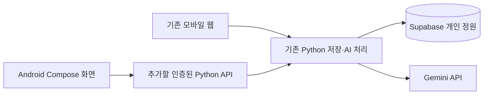

# Android 시험 설치 앱 준비

기준일: 2026-10-16. 목표는 **12월 초 발표에서 실제 Android 휴대폰에 설치해 핵심 흐름을 시연하는 APK**입니다.
현재 제공 중인 제품은 Streamlit 모바일 웹이며, **Android 프로젝트·API 서버·설치 파일은 아직 구현 전**입니다.
아래 일정은 작업 계획이며 완료 실적이 아닙니다. 최종 발표일, 시험 기기와 학사 일정에 맞춰 조정합니다.

**10/19 중간발표는 현재 모바일 웹으로 시연합니다.** Android는 12월 목표와 준비 계획으로 설명하며, 중간발표 전에 앱 전환을 완료할 필요는 없습니다.
현재 사용할 Android 휴대폰이 없어 에뮬레이터로 시작합니다. 실기기 시험은 아직 예정이며, 에뮬레이터 확인을 실기기 검증으로 표시하지 않습니다.

## 이번 목표와 개발 방향

Android 화면은 **Kotlin + Jetpack Compose**, 기존 Python 기능을 연결할 API는 **FastAPI**를 기본안으로 준비합니다.
Android만을 우선해 클라이언트 종류를 늘리지 않고, 기존 모바일 웹 테스트와 Python 저장·AI 로직을 활용합니다.
이메일 로그인과 개인 정원은 웹·Android 공통 계정으로 사용합니다. Play 스토어 공개 출시와 iPhone 앱은 이번 시험판의 필수 범위에 넣지 않습니다.

핵심 시연 범위는 정원 조회, 식물·사진 등록, 관리 기록, AI 제안, 케어 일정, 완료·경과 연결입니다.
AI 비교 실험과 상세 백업 관리 화면은 우선 기존 웹에서 사용합니다. 캘린더 내보내기는 유지하고 앱 자체 알림은 핵심 데이터 흐름 연결 뒤 추가합니다.

## 현재 코드에서 재사용할 부분

| 기존 코드 | 활용 방향 |
|---|---|
| `storage.py`, `snapshot.py`, `cloud_store.py` | 식물·관리 기록·제안·일정 검증과 저장, 충돌 방지·백업 형식 유지 |
| `ai_context.py`, `gemini.py` | 최근 기록·제안·경과를 포함한 AI 입력과 호출·오류 처리 |
| `weather.py`, `media.py`, `time_utils.py` | 날씨·사진 처리와 한국 기준 날짜 검증 |
| `calendar_export.py`, `schedule_text.py` | 짧은 일정 제목과 원문·확인 조건을 담은 캘린더 내용 |
| `app.py`, `*_ui.py`, `assets/style.css` | Streamlit 화면이므로 Compose 화면으로 새로 구성 |

모바일 앱에 Gemini 키나 Supabase 서버용 Secret key를 넣지 않습니다. 앱은 사용자 인증 토큰으로 API에 요청하고 서버가 권한을 확인합니다.
웹의 Supabase Auth 이메일·비밀번호 계정을 Android에서도 사용합니다. 별도 API는 매 요청의 JWT를 검증하고 사용자 JWT로 RLS에 접근합니다. owner_id 입력만으로 권한을 판단하지 않습니다. [계정 안내](ACCOUNTS.md)
처음에는 별도 시험 데이터로 연결하고, 원격 개인 정원으로의 쓰기는 인증·동시 저장 검증을 마친 뒤 추가합니다.

## 첫 번째 완료 목표

**에뮬레이터에 시험 APK 설치 → 예시 식물 목록 → 식물 상세 조회**까지 한 흐름을 먼저 만듭니다.

1. Android Studio와 SDK를 준비하고 기본 Empty Activity를 생성합니다. 예시 화면만 표시하는 첫 빌드로 설치 환경을 확인합니다.
2. API 응답 형식에 맞춘 가상 식물 목록을 Compose 화면에 표시합니다. 네트워크 미연결 상태의 예시라는 표시를 둡니다.
3. Python에서 현재 저장 로직을 호출하는 조회 API를 만들고, 임시 정원으로 목록·상세·없는 식물·오류 응답을 시험합니다.
4. Android에서 API 조회를 연결해 로딩·빈 목록·실패·재시도를 표시합니다. 재시도는 읽기 요청에만 적용하고 실제 AI 요청은 자동 반복하지 않습니다.
5. 에뮬레이터에서 조회·뒤로 가기·앱 복귀를 확인하고 등록과 사진 업로드로 넓힙니다. 실제 기기를 확보하면 같은 흐름과 사진·알림을 다시 시험합니다.

초기 API 형식은 [조회 API 계약 초안](../contracts/android-read-api.openapi.json)에 적었습니다. 이는 **서버 구현이나 실행 주소가 아닌 설계 파일**입니다.

| 예정 경로 | 역할 | 공개 전 조건 |
|---|---|---|
| `GET /health` | 민감한 설정 없이 서버 준비 상태 표시 | 외부 서비스의 정상 연결까지 보장하는 응답으로 사용하지 않음 |
| `GET /v1/plants` | 앱에 필요한 식물 요약 목록 | 사용자 JWT 인증과 본인 정원 접근 확인 |
| `GET /v1/plants/{plant_id}` | 식물 상세 조회 | 같은 접근 확인, 잘못된 ID·없는 식물 처리 |

이미지 경로나 서버 파일명·비밀키는 응답하지 않고, 첫 조회 단계에는 사진 유무만 표시합니다.
사진 전송과 쓰기 API는 다음 단계 계약에서 별도 정의합니다. 스냅샷 형식은 유지하고 사용자별 테이블·RPC·사진 RLS를 사용합니다.

## 준비 순서와 완료 기준

| 기간 | 작업 목표 | 확인할 완료 기준 |
|---|---|---|
| 10/16–10/22 | 웹 중간발표·환경·첫 화면 | 10/19 웹 시연, 에뮬레이터에 예시 화면 APK 첫 설치, 조회 API 연결 준비 |
| 10/23–11/01 | 인증된 조회·등록·기록·사진 | 에뮬레이터에서 등록 후 재접속 조회, 인증 실패 처리, 웹/앱 동시 저장 충돌 확인 |
| 11/02–11/08 | AI 분석·제안·경과 | 앱의 명시적 동의 후 요청, 기록 포함·한도 오류·저장 결과 확인 |
| 11/09–11/15 | 일정·캘린더·기기 알림 | 완료·경과 연결, 캘린더 시간 일치, 알림 권한과 실제 수신 확인 |
| 11/16–11/22 | 팀원 APK 시험 | 다른 장소·다른 기기에서 HTTPS API 접속과 핵심 흐름 확인, 기능 추가 마감 |
| 11/23–11/30 | 수정·재시험·발표 준비 | APK 버전 고정, 설치 안내·시연 영상·저장된 AI 결과 예비안 준비 |

11/01에 에뮬레이터의 인증된 조회·기록 저장이 안 되면 추가 기능을 줄이고 핵심 흐름을 우선합니다.
11/08까지 팀원·주변의 Android 기기를 빌릴 수 있는지 확인하고 기종·OS를 기록합니다. 확보하지 못하면 실기기 검증을 미완료로 남기고 발표 시연 범위를 에뮬레이터로 명시합니다.
자체 알림이 지연되면 현재 캘린더 알림을 시험판 대안으로 사용하고 구현 범위를 발표에 표시합니다.
11월 말에는 새 화면·기능을 추가하지 않고 재시험과 발표 준비에 집중합니다.

## Android 개발 환경 준비

2026-10-16 기본 설치 경로와 PATH 확인에서는 Android Studio·SDK·Java·adb를 찾지 못했습니다. 다른 경로에 설치했다면 실제 위치를 먼저 확인합니다.
Android 개발 환경 설치는 웹 테스트를 하는 팀원 모두에게 필요하지 않습니다. 앱 개발 PC와 시험 기기에만 준비합니다.

1. [Android Studio 공식 페이지](https://developer.android.com/studio)에서 Windows용 안정 버전을 설치하고 SDK 초기 설정을 진행합니다.
2. Android Studio의 **New Project → Empty Activity**로 Kotlin/Compose 프로젝트를 만듭니다. 실제 프로젝트와 버전 파일은 생성·빌드가 확인된 뒤 저장소에 추가합니다.
3. Android Studio의 Device Manager에서 일반 휴대폰 프로필과 안정 Android 시스템 이미지를 선택해 에뮬레이터를 만듭니다. SDK 버전·프로젝트 버전은 첫 빌드에서 함께 고정합니다.
4. 에뮬레이터를 실행 대상으로 선택해 기본 화면을 실행합니다. 사진·알림의 실제 동작은 추후 실기기에서 별도로 확인합니다. 실기기 연결·USB 디버깅 허용은 기기 소유자가 직접 진행합니다.

API 서버는 Streamlit 화면과 별도로 실행·배포할 프로세스가 필요합니다. 호스팅·비용과 외부 주소는 아직 정하지 않았습니다.
PC의 `127.0.0.1`은 휴대폰의 서버 주소가 아닙니다. 개발 중 연결은 Android Studio의 기기 연결 방식에 맞춰 구성하고, 외부 시험판은 HTTPS 서버를 사용합니다.
서버와 앱의 의존성은 별도 파일로 관리해 현재 웹의 `requirements.txt`와 배포를 먼저 바꾸지 않습니다.

## 병행 테스트

현재 [M01–M13 모바일 웹 테스트](TEAM_TESTING.md)는 계속 진행합니다. 결과에 **웹/Android 앱, 앱 버전, 기종·OS**를 구분해 기록합니다.
앱을 옮긴 뒤에는 웹에서 통과한 기능도 다시 시험합니다. APK 설치·업데이트, 사진 선택·권한, 키보드·뒤로 가기, 앱 복귀, 알림 권한·수신, 네트워크 끊김을 추가합니다.
서로 다른 기기가 같은 계정의 정원을 변경할 때의 충돌과 중복 실행 방지도 확인합니다.

## 공식 참고 문서

- [Android Compose 첫 화면](https://developer.android.com/develop/ui/compose/tutorial)
- [Android 실기기 실행](https://developer.android.com/studio/run/device)
- [Android 네트워크 연결](https://developer.android.com/develop/connectivity/network-ops/connecting)
- [Android 알림 권한](https://developer.android.com/develop/ui/compose/notifications/notification-permission)
- [FastAPI 테스트](https://fastapi.tiangolo.com/tutorial/testing/)
- [Supabase 사용자 토큰 검증](https://supabase.com/docs/reference/python/auth-getclaims)
