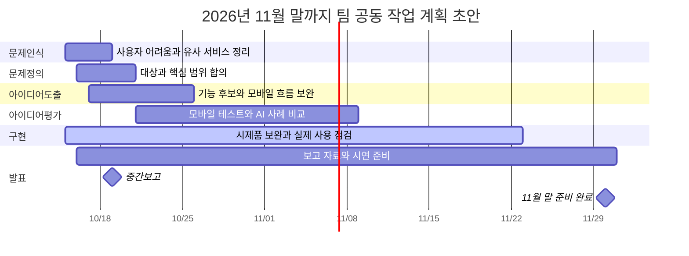

# 팀 운영체계와 중간보고 초안

기준일: 2026-10-15. 중간보고는 **2026-10-19 월요일**, 계획표는 **11월 30일까지**입니다.
최종 발표는 12월 초 예정이며 정확한 날짜는 미정입니다. 팀 이름·역할·운영 규칙과 아래 세부 일정은 **팀 합의 전 초안**입니다.
2026-10-16 갱신: **10/19 중간발표는 현재 모바일 웹으로 시연**하고, Android 시험 설치 앱은 12월 목표와 준비 계획으로 설명합니다.

## 팀 이름과 한 문장 목표

- 팀 이름 제안: **초록동행**
- 서비스 이름: **내 식물 기록 · Plant Care AI**
- 프로젝트 목표: **식물의 사진과 관리 이력을 바탕으로 AI가 확인 조건과 다음 케어를 제안하고, 실행 후 경과까지 기록하는 모바일 웹과 Android 시험 설치 앱을 구현하고 검증한다.**

문제 가설은 ‘초보 식물 사용자가 물주기 시점과 지난 관리 이후의 변화를 기억하고 판단하기 어렵다’입니다.
사용자 인터뷰로 입증한 결론은 아직 아닙니다. 팀원 사용성 점검과 원예 자료 확인, 실제 식물 관찰을 통해 검토합니다.

## 4명 역할 배정안

담당자 이름과 세부 역할은 팀 회의에서 정하고, 작업 범위와 가능한 시간을 함께 확인합니다.

| 구성원 | 운영 역할 | 첫 산출물과 구현 참여 | 발표 분담안 |
|---|---|---|---|
| 팀장 | 팀장, 개발 통합 | 코드·배포 구조 정리, 오류 재현·통합, 수정 과제 관리 | 목표·구현 현황·시연 |
| 팀원 A | 기록자, 모바일 테스트 담당 | 회의록과 테스트 결과표, 재현 가능한 Issue, 화면 문구/여백 수정 PR | 운영 규칙·테스트 방법 |
| 팀원 B | 자료수집자, AI 평가 담당 | 유사 서비스·원예 자료 출처 정리, 3개 사례 평가, 확인 문구/사례 보완 PR | 문제인식·아이디어 평가 |
| 팀원 C | 보고서작성자, 일정 관리 담당 | 발표자료·간트 갱신, 화면 흐름 정리, README/사용 안내 PR | 일정·남은 과제 |

발표자는 한 명으로 제한하지 않습니다. 위처럼 나누되 발표 시간에 따라 대표 발표자를 정할 수 있습니다.
각자 조사·테스트 결과가 실제 수정으로 이어지도록 작은 구현 과제를 한 건씩 맡고 팀장이 함께 리뷰합니다.

## 팀 운영 규칙 5개

1. **매주 월요일 20분 회의**에서 지난 산출물과 다음 할 일을 정하고, 기록자가 같은 날 회의록을 공유한다. 시간은 팀 합의로 정한다.
2. **모든 할 일은 담당자·기한·완료 조건**을 적는다. 맡기 어려우면 마감 24시간 전까지 알려 범위를 조정한다.
3. **코드와 문서는 작업 브랜치와 PR**로 공유하고, 다른 팀원 한 명이 실행 결과 또는 문서를 확인한 뒤 통합한다.
4. **기록은 사실대로 구분**한다. 실제 관찰과 가상 테스트를 표시하고, 팀 테스트 결과를 실행 전에 통과로 적지 않는다. 비밀키는 공유 문서나 GitHub에 올리지 않는다.
5. **범위·역할·일정 변경은 팀이 합의하고 기록**한다. 11월 22일부터 기능 추가를 멈추고 오류 수정·재검증·발표 준비를 우선한다.

규칙 3은 제안하는 팀 협업 방식입니다. 현재 GitHub에 강제 리뷰 규칙을 설정한 것은 아닙니다.

## 교수님 지정 6단계 간트 계획

기존 시제품은 10월 15일 현재 구현·개발 확인을 마친 상태입니다. 아래 문제인식·문제정의·아이디어도출은 팀 공동 검토와 문서 보완 일정입니다.
개발을 처음부터 순차 시작한 것으로 소급해 표시하지 않습니다. 팀 검토와 기존 구현 보완은 겹쳐 진행합니다.

| 단계 | 시작 | 종료 | 완료할 산출물 |
|---|---|---|---|
| 문제인식 | 10/15 | 10/18 | 대상 사용자의 어려움 가설, 유사 서비스 비교와 출처 |
| 문제정의 | 10/16 | 10/20 | 대상 사용자·핵심 문제·이번 발표까지 구현 범위 |
| 아이디어도출 | 10/17 | 10/25 | 기능 후보와 모바일 사용 흐름, 기능 선정 이유 |
| 아이디어평가 | 10/21 | 11/08 | M01–M13 모바일 테스트, A01 연결 점검, AI 3개 사례 비교와 평가 이유 |
| 구현 | 10/15 | 11/22 | 기존 시제품 보완, 오류 수정, 가능한 경우 실제 식물 기록 및 경과 확인 |
| 발표 | 10/16 | 11/30 | 10/19 중간보고, 11/29 리허설, 11/30 자료·시연 준비 완료 |

### 주요 기준일

- **10/18 일요일:** 팀 이름·목표·역할·규칙 합의, 중간보고 리허설.
- **10/19 월요일:** 중간보고. 구현 현황과 아직 수집 전인 검증 결과를 구분해 발표.
- **10/25:** 모바일 1차 피드백과 기능 후보 선정 근거 정리.
- **11/08:** AI 비교 평가와 모바일 문제 목록 1차 정리. 실제 식물 확보 여부에 따라 검증 범위 확정.
- **11/22:** 기능 추가 마감. 이후는 오류 수정·재검증·백업·발표 준비.
- **11/29–11/30:** 리허설과 최종 자료·시연 예비안 준비. 12월 초 최종 발표일 확정 후 제출 일정 조정.

## 중간보고 발표 구성

1. 팀 이름과 프로젝트 목표 한 문장
2. 4명 역할과 첫 산출물
3. 팀 운영 규칙 5개
4. 6단계 간트 차트와 주요 기준일
5. 현재 구현 범위와 확인한 동작, 남은 검증
6. 휴대폰 테스트 순서와 결과 수집 방법
7. 중간보고 이후 우선순위와 최종 발표 범위

현재 구현은 등록·사진·관리 기록, Gemini 연동, 제안/실행/경과 연결, 순천 등 지역 날씨, 기록 유무 비교, Supabase 저장, 케어 일정과 캘린더 내보내기입니다.
2026-10-15 개발 환경에서 자동 테스트 80개가 통과했습니다. 공유 앱에서는 예시 입력으로 AI 연결과 일정/관리 기록/경과 연결·재접속 보존을 확인했습니다.
휴대폰 기기별 테스트, 실제 알림 수신, 실제 식물 관리 효과는 아직 검증 전입니다. 구현률·정확도·사용자 만족도 같은 수치는 만들지 않습니다.

## 프로젝트 현황 요약

기본 웹 시제품을 구현하고 예시 데이터로 주요 기능의 동작을 확인했습니다.
다음 단계는 팀원 모바일 테스트, AI 제안 평가, 실제 식물 관찰과 발견한 문제의 보완입니다.
중간보고에는 현재 구현 범위와 확인 결과, 남은 검증 및 개발 일정을 정리합니다.

담당 작업과 진행 상황은 회의록과 Issue·PR에 기록합니다.

## 최종 발표까지의 범위와 위험

- 2026-10-16 갱신: 이번 목표는 **모바일 웹 검증과 Android 시험 설치 APK**입니다. 이메일 로그인·개인 정원은 웹·Android 공통 계정으로 준비합니다. 앱스토어 출시·iPhone·서버 푸시는 후속 범위로 둡니다. [Android 준비 계획](ANDROID_PLAN.md)에 세부 순서와 완료 기준을 정리했습니다.
- 실제 식물은 10월 안에 확보를 시도합니다. 확보하지 못하면 가상 사례와 사용성 검증으로 결과 범위를 명시하고 효과를 주장하지 않습니다.
- 한도 오류에 대비해 담당자 한 명이 AI 비교를 실행하고 결과를 내려받습니다. 3사례를 각 1쌍씩 실행하면 기본 6회이며, 추가 재시도는 별도입니다.
- 발표 때 API가 실패하면 사전에 저장한 예시 결과로 시연하고, 저장 결과 재생이라는 점을 밝힙니다.
- 학사 일정과 시험 기간은 아직 반영하지 않았습니다. 팀원이 가능한 시간을 확인해 각 단계 범위를 조정합니다.

연결 문서: [팀원 테스트](TEAM_TESTING.md), [케어 일정](CARE_SCHEDULES.md), [AI 비교](AI_COMPARISON.md), [개발 계획](ROADMAP.md).
